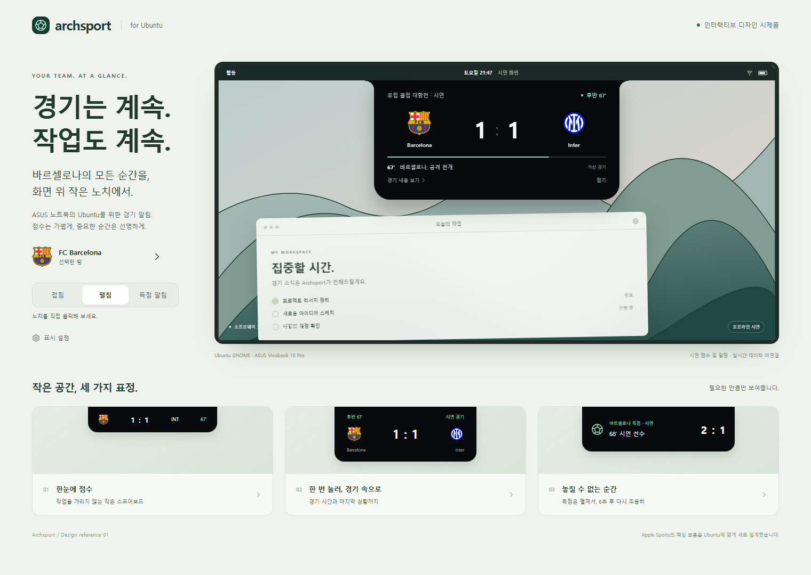

# Archsport

**ASUS Vivobook 15 Pro · Ubuntu GNOME · FC Barcelona**를 위한 경기 알림 노치. 물리 노치 없이 GNOME 상단 패널 아래에 점수·골·VAR·HT·FT를 표시합니다.

**Linux Codex에서 이어서 작업하려면 먼저 [docs/LINUX_HANDOFF.md](docs/LINUX_HANDOFF.md)를 읽으세요.** 원래 채팅이나 Windows Codex와 연결할 필요가 없습니다.

## 현재 구현

- 실제 Barcelona/Inter 구단 로고 포함. 실제 상대 팀의 로고는 공급사 팀 ID로 받아 로컬 캐시.
- 기본 **live** 모드. 키가 없으면 설정 필요 상태를 표시하며 가짜 경기로 대체하지 않음.
- `fixtures`를 polling하고 점수·상태 변경 때만 `events` 요청. 사건 조회가 실패해도 새 점수는 유지.
- Barcelona 팀 ID를 정확한 이름/국가로 자동 결정하고 SQLite에 캐싱.
- 패널의 FCB 메뉴에서 다음 경기·최근 4경기 결과·가장 최근 경기 기본 스탯을 확인한다. 노치는 경기 중에만 자동 표시된다.
- 경기 중 기본 120초(설정 60–300초) / 경기 없음 30분 / 경기 전 킥오프까지 15분 여유 / 종료 후 다음 경기 대기.
- 중복·VAR·재시작·재연결 기준값 처리, 오프라인 캐시 복구.
- `prefs.js + GSettings`: 팀·국가·데이터 모드·API 키·간격·예산·노치 표시·알림 시간·모니터·스포일러 설정.
- subprocess 종료 시 자동 재시작, logind 절전/복귀 신호 처리.
- matci와 함께 설치하면 패널 아래 중앙 그룹으로 배치하고, 한쪽을 펼칠 때 다른 노치를 접음. 실제 GNOME 동시 표시 검수는 진행 전.
- Windows 브라우저용 노치/애니메이션 시제품과 오프라인 경기 replay.

개인 API 키를 설정창에 저장한 상태이나, 실제 경기 데이터·일정·스탯 응답은 아직 확인하지 않았습니다. GNOME Shell GUI·ASUS 실제 배율·절전은 실기기 검수가 필요합니다.

## Ubuntu에서 시작

```bash
gh repo clone halfsamoan/archsport
cd archsport
python3 -m unittest discover -s tests -v
python3 tools/doctor.py
sudo apt install python3 libglib2.0-bin gnome-shell-extension-prefs
python3 tools/install_extension.py
```

비공개 저장소라면 먼저 같은 GitHub 계정으로 `gh auth login`을 수행합니다. 설치 후 **로그아웃·로그인**하고:

```bash
gnome-extensions enable archsport@local
gnome-extensions prefs archsport@local
```

설정창에서 개인 API-Football 키를 입력하고 적용합니다. JSON 수정이나 확장 수동 재활성화 없이 적용됩니다. 키는 `$XDG_CONFIG_HOME/archsport/api-key` (기본 `~/.config/archsport/api-key`)에 0600 권한으로 저장하며 GitHub·GSettings·stdout에 넣지 않습니다. 구독·결제는 자동으로 하지 않습니다.

`daily-budget=90`은 무료 요금제 보호 설정입니다. 진행 중 경기는 기본 120초 간격이며, 일정·최근 결과·통계 응답은 각각 로컬 DB에 캐시합니다. 무료 100회/일 안에서 하루 종일 경기를 추적할 수 있다고 보장하지는 않습니다. 설정에서 요청 상한과 갱신 간격을 조정할 수 있습니다. [공급사 요금](https://www.api-football.com/pricing)

지원 목표는 GNOME 46/50입니다. GNOME 42의 Ubuntu 22.04는 이 ESM 확장 대상이 아닙니다. 설치할 Ubuntu의 버전을 `gnome-shell --version`으로 확인하세요.

업데이트는 실행 중인 확장을 백업한 뒤 교체합니다:

```bash
git pull --ff-only
python3 tools/install_extension.py --upgrade
```

설치 뒤 현재 세션에서 확장을 다시 켭니다:

```bash
gnome-extensions enable archsport@local
```

GNOME이 이미 불러온 확장은 다른 버전의 코드를 현재 세션에서 다시 읽지 않을 수 있습니다. `gnome-extensions info archsport@local`에서 설치한 버전이 보이지 않으면 다음 사용자 세션 진입 뒤 적용됩니다. 실제 재로그인 자동 시작도 별도 실기기 검수 항목입니다.

## 키 없이 확인

```bash
python3 -m archsport --demo --once
python3 -m archsport --replay data/replay-barcelona.json
```

GNOME 설정의 데이터 모드를 `시연`으로 선택하면 동봉된 가상 경기 흐름을 재생합니다. 실제 클럽 로고를 사용하지만 대진·점수·선수·시간은 시연입니다. 실데이터로 표기하지 않습니다.

## Windows에서 디자인 보기

```powershell
python -m http.server 4173 --bind 127.0.0.1 --directory web
```

<http://127.0.0.1:4173>에서 접힘·펼침·득점 알림·6초 후 접힘·상세·설정·오프라인을 확인합니다. 웹 설정은 브라우저 시연 전용이며 Ubuntu GSettings와 동기화되지 않습니다.



## 파일 안내

| 경로 | 내용 |
|---|---|
| `docs/LINUX_HANDOFF.md` | Linux Codex 인계서·사용자 의도·P0 검수·작업 순서 |
| `AGENTS.md` | 채팅 없이 적용할 저장소 작업 지침 |
| `archsport/` | 데이터·상태·폴링·로고·JSON Lines worker |
| `extension/` | GNOME Shell 표면·설정창·GSettings schema |
| `web/` | Windows에서도 동작하는 UI 시제품·실제 팀 로고 |
| `data/` | 가상 공급사 응답·전체 경기 replay·데이터 출처 안내 |
| `replica/recon.md` | Apple Sports 원본 조사와 Linux 제안 |
| `replica/features.csv` | 기능별 구현 및 검증 상태 |
| `replica/architecture.md` | 현재 구조·요청량·IPC·후속 계획 |
| `replica/verification.md` | 실제 실행한 검증과 미검증 구분 |

키·로컬 SQLite·쿠키·dconf·세션 파일은 공유하지 않습니다. 경기 데이터는 새 컴퓨터의 개인 키로 다시 수신합니다. 구단 마크의 권리는 각 권리자에게 있으며 출처와 원본 파일 해시는 `web/assets/logos/manifest.json`에 있습니다.
