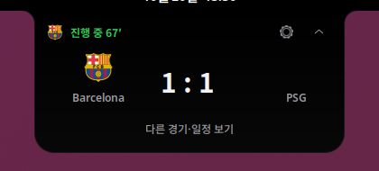

# Archsport

Barcelona, Lazio, Como의 일정과 경기 점수를 Ubuntu GNOME 노치에 표시합니다.

경기 중에는 점수와 상태를 보여주고, 경기가 없으면 노치를 숨깁니다. 일정과 최근 결과는 패널 메뉴에서 열 수 있습니다.



합성 경기로 구성한 시연 화면입니다.

## Install

GNOME Shell 50, Python 3, GLib 스키마 도구와 GNOME 확장 설정 도구가 필요합니다. 저장소 루트에서 실행합니다.

```sh
python3 tools/install_extension.py
```

## Quickstart

첫 설치 후 로그아웃하고 다시 로그인한 뒤 활성화합니다.

```sh
gnome-extensions enable archsport@local
gnome-extensions prefs archsport@local
```

설정의 **데이터**에서 API-Football 키와 football-data.org 키를 각각 입력합니다. 넘버패드 `Enter`로 노치를 열고 닫습니다.

키 없이 CLI의 경기 흐름을 살펴보려면 저장소 루트에서 실행합니다.

```sh
python3 -m archsport --demo --once
```

## 경기 데이터

- **일정·결과:** football-data.org에서 지원 대회의 정보를 가져와 캐시합니다.
- **경기 중 상태:** API-Football로 점수와 상태를 조회하고 변경을 알립니다.
- **조회 조절:** 다음 킥오프와 진행 상태에 따라 요청 빈도를 조절합니다.
- **로컬 설정:** API 키와 경기 상태를 사용자 디렉터리에 보관합니다.

공급사의 데이터 지연과 사용 한도가 적용됩니다. 무료 API를 통한 실시간성은 보장하지 않으며, 경기별 통계와 선발 라인업은 제공하지 않습니다.

## 현재 상태

실제 GNOME에서의 경기 알림·절전 복귀·배율·[matci](https://github.com/halfsamoan/matci) 동시 표시 검수는 남아 있습니다.

[설치·업데이트·개발 절차](CONTRIBUTING.md) · [Linux 검수](docs/LINUX_HANDOFF.md) · [구현 현황](docs/TWO_APP_IMPLEMENTATION_STATUS.md)

## License

[MIT](LICENSE). 구단 표장은 각 권리자 소유이며 [출처 목록](web/assets/logos/manifest.json)을 따릅니다.
