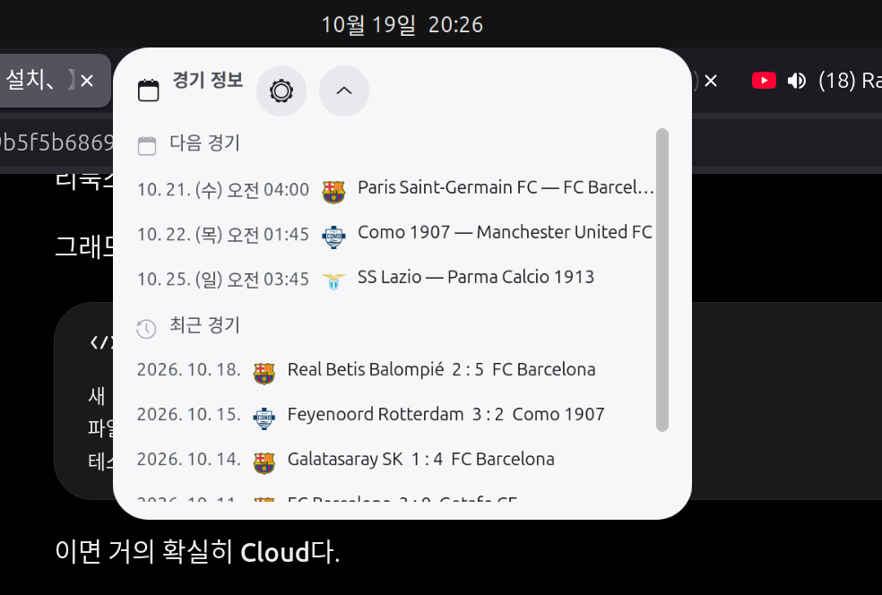
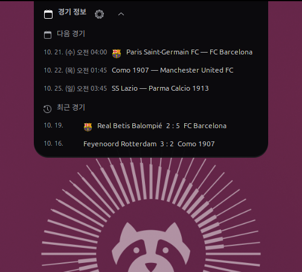
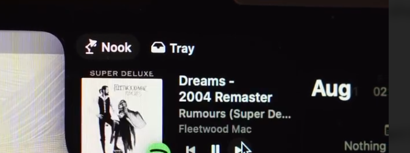
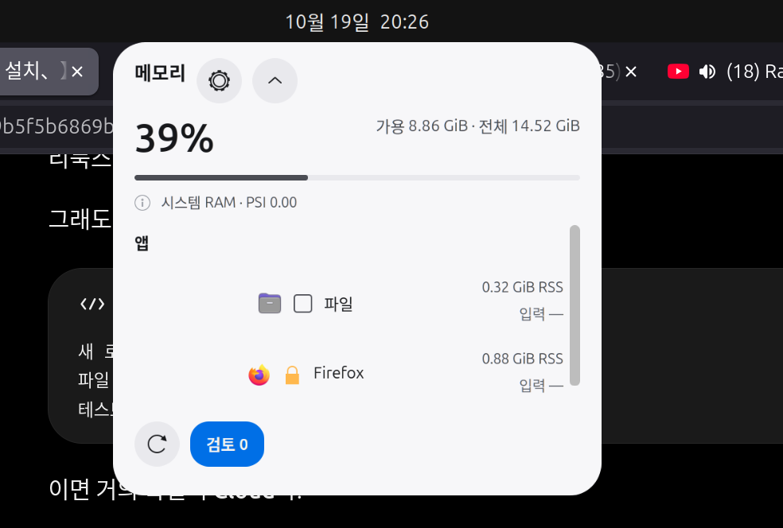

# 시각 레퍼런스 보드

외부 제품/Apple 이미지는 저작권과 원본 추적을 위해 복제하지 않고
[13개 링크와 관찰표](../reference-research.md)로 연결한다. 사용자가 제공한
이미지 4장은 [`../reference/`](../reference/)에 보존했다.

| 분류 | 이미지 | 비교 질문 |
| --- | --- | --- |
| Mac 노치 영상 캡처 | [01](../reference/mac-notch-01.png), [02](../reference/mac-notch-02.png) | 상단과 연결되는 검은 덩어리인가? 펼침에 어디까지 커지는가? |
| 현재 Archsport | [v15](../reference/current-archsport.png) | 밝은 표면, 모서리, 6개 최근 결과, 날짜, 스크롤이 무엇을 먼저 보이게 하는가? |
| 현재 matci | [v12](../reference/current-matci.png) | 숫자보다 버튼/설명/스크롤이 먼저 읽히는가? |

이 화면들에서 reference의 물리 노치 검은 영역을 GNOME 시스템 패널 자체로
복제할 수는 없다. GNOME 패널 아래에 0–1px 간격으로 붙는 시각 형태를 목표로
한다. 외부 자료의 정확한 px, blur, easing은 검증되지 않았다.

## GNOME 50.1에서 렌더링한 비교

아래 오른쪽 이미지는 사용자 세션이 아닌 격리된 GNOME Shell의 합성 상태다.
[Archsport 캡처와 반복 기록](../iterations/README.md),
[matci 캡처와 반복 기록](../../../../matci/docs/design/iterations/README.md)에
상태별 증거를 정리했다.

| 사용자 제공 Mac 레퍼런스 | 이전 GNOME 화면 | 새 Archsport 네이티브 렌더 |
| --- | --- | --- |
|  |  |  |

| 사용자 제공 Mac 레퍼런스 | 이전 GNOME 화면 | 새 matci 네이티브 렌더 |
| --- | --- | --- |
|  |  |  |
